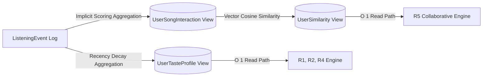

# 🎵 TuneSense

> **Music that understands your vibe.**  
> *A Personalized, Context-Aware and Explainable Music Recommendation System Using NoSQL*

[](https://www.typescriptlang.org/)
[](https://react.dev/)
[](https://vitejs.dev/)
[](https://nodejs.org/)
[](https://www.mongodb.com/atlas)
[](https://tailwindcss.com/)
[](LICENSE)
[]()

---

## ⚡ 60-Second Quick Start

Get TuneSense running locally in under a minute with pre-seeded data:

```bash
# 1. Clone the repository
git clone https://github.com/kousthub-eswar/tunesense.git
cd tunesense

# 2. Install all dependencies (root, client & server)
npm run install:all

# 3. Seed deterministic demo accounts & catalog
npm run seed

# 4. Start both API server and React client concurrently
npm run dev:both
```

* 🌐 **Frontend Client:** [http://localhost:5173](http://localhost:5173)
* 🚀 **Backend REST API:** [http://localhost:5000](http://localhost:5000)
* 🩺 **Health Check:** [http://localhost:5000/api/health](http://localhost:5000/api/health)

---

## 🎭 Pre-Configured Demo Accounts

TuneSense comes pre-seeded with four realistic listener personas to test every recommendation state immediately:

| Persona | Email | Password | What It Demonstrates |
| :--- | :--- | :--- | :--- |
| **Alice Parker** *(Power User)* | `alice@demo.tunesense.ai` | `DemoPassword123!` | High-energy Electronic/Ambient listener. Deep listening history, mature taste profile, and active collaborative neighbor pairings. |
| **Bob Martinez** *(Collaborative Peer)* | `bob@demo.tunesense.ai` | `DemoPassword123!` | Shares electronic taste profile with Alice. Triggers **R5 Collaborative Hybrid** recommendations based on cosine similarity. |
| **Charlie Vance** *(Diverse Taste)* | `charlie@demo.tunesense.ai` | `DemoPassword123!` | Rock & Indie listener with explicit dislikes for Electronic. Demonstrates genre suppression and diversity filters. |
| **Dana Sterling** *(Cold-Start User)* | `dana@demo.tunesense.ai` | `DemoPassword123!` | Brand new listener with zero interaction history. Demonstrates **R0 Popularity Baseline**, taste onboarding wizard, and cold-start graceful degradation. |

---

## 📑 Table of Contents

- [Overview & Core Value](#-overview)
- [System Architecture](#-system-architecture)
- [Recommendation Engine (R0–R5)](#-recommendation-engine-r0r5)
- [Transparent Explainability (XAI) & Privacy](#-transparent-explainability-xai--privacy)
- [Offline Evaluation Framework](#-offline-evaluation-framework)
- [NoSQL Data Modeling & Materialized Views](#-nosql-data-modeling--materialized-views)
- [Key Features & Design System](#-key-features--design-system)
- [Security & Hardening](#-security--hardening)
- [Automated Verification & Testing](#-automated-verification--testing)
- [Environment Configuration](#-environment-configuration)
- [Cloud Deployment (Vercel + Render + Atlas)](#-cloud-deployment)
- [Project Directory Structure](#-project-directory-structure)
- [Academic Contribution](#-academic-contribution)
- [License](#-license)

---

## 💡 Overview

Traditional commercial music recommenders often operate as opaque "black boxes" that prioritize global virality over user intent, obscure why specific tracks are suggested, and struggle with temporal contexts (e.g., late-night relaxation vs. midday workouts).

**TuneSense** solves this by uniting:
1. **Multi-Strategy Recommendation Architecture (R0–R5):** Blends popularity, acoustic content similarity, short-term behavioral recency, temporal context, and collaborative filtering.
2. **Transparent Explainability (XAI):** Generates human-readable rationales directly tied to the dominant scoring signal without compromising peer privacy.
3. **NoSQL Document Engineering:** Leverages MongoDB document modeling, append-only telemetry, and precomputed materialized views to eliminate expensive run-time joins.
4. **Scientific Offline Evaluation:** Built-in evaluation framework calculating **Precision@K**, **Recall@K**, **HitRate@K**, **NDCG@K**, **Intra-List Diversity**, and **Novelty@K** using temporal train/test partitioning to prevent data leakage.
5. **Real-World Catalogue Resilience:** Integrates the Jamendo REST API for legal Creative Commons audio streaming, backed by an offline acoustic cache for uninterrupted playback.

---

## 🏗️ System Architecture

```
                    ┌────────────────────────────────────────┐
                    │    React 18 SPA (Vite + Tailwind)      │
                    │  Desktop Sidebar / Mobile AppShell     │
                    │  Persistent HTML5 Audio Player Queue   │
                    └───────────────────┬────────────────────┘
                                        │ HTTP / REST (JWT Cookies)
                                        ▼
                    ┌────────────────────────────────────────┐
                    │       Node.js / Express REST API       │
                    │      Strict TypeScript 5.7 + Zod       │
                    └─────┬──────────────┬─────────────┬─────┘
                          │              │             │
        ┌─────────────────┘              │             └─────────────────┐
        ▼                                ▼                               ▼
┌──────────────────┐           ┌──────────────────┐            ┌──────────────────┐
│   Auth & Security│           │  Telemetry & Recs│            │ Music Catalogue  │
│  • Bcrypt (x12)  │           │  • Candidate Gen │            │  • Jamendo API   │
│  • HttpOnly JWT  │           │  • R0–R5 Scorers │            │  • Audio Stream  │
│  • Rate Limiting │           │  • Explainers    │            │  • Fallback Cache│
└──────────────────┘           └─────────┬────────┘            └──────────────────┘
                                         │
                                         ▼
                      ┌────────────────────────────────────┐
                      │        MongoDB Atlas (NoSQL)       │
                      │                                    │
                      │  Raw Logs (Append-Only):           │
                      │  • ListeningEvent                  │
                      │  • RecommendationImpression        │
                      │                                    │
                      │  Materialized Views (Precomputed): │
                      │  • UserTasteProfile (Decay λ=0.05) │
                      │  • UserSongInteraction (Sparse)    │
                      │  • UserSimilarity (Cosine Sim)     │
                      │                                    │
                      │  Domain Collections:               │
                      │  • User, UserPreference            │
                      │  • UserLibrary, Playlist           │
                      │  • Song, Artist, Album             │
                      └────────────────────────────────────┘
```

---

## 🧠 Recommendation Engine (R0–R5)

TuneSense does not rely on a single rigid heuristic. It deploys a composable multi-layer hierarchy of six distinct recommendation strategies:

```
[Candidate Generation: Content + Popularity + Collaborative Seeds]
                                │
                                ▼
[Hard Constraints: Deduplication + Cool-Off Filter + Disliked Genres Exclusion]
                                │
                                ▼
  ┌─────────────────────────────┴─────────────────────────────┐
  │ Scoring Stage (Normalized [0, 1]):                         │
  │ • R0 Popularity Baseline (Catalog play count & engagement)│
  │ • R1 Content Fit (Cosine acoustic distance & genres)      │
  │ • R2 Behavioral Trend (30-day exponential recency decay)  │
  │ • R3 Context Fit (Time-of-day & day-of-week alignment)    │
  │ • R5 Collaborative Neighbor Fit (User interaction overlap)│
  └─────────────────────────────┬─────────────────────────────┘
                                │
                                ▼
[R4 Hybrid Composition: Dynamic Weight Blending + Active Mood Heuristics]
                                │
                                ▼
[Post-Processing: Artist & Album Capping (Max 2) + Exploration Slots]
                                │
                                ▼
[Transparent Explainability Badge Mapping & Impression Telemetry Logging]
```

### Strategy Summary

| Strategy | Primary Signal | Mathematical Formulation / Logic | Primary Use Case |
| :--- | :--- | :--- | :--- |
| **R0 — Popularity Baseline** | Catalog engagement | $\text{score} = \frac{\log(1 + \text{plays})}{\log(1 + \text{maxPlays})}$ | Cold-start listeners with zero history |
| **R1 — Content Personalization** | Acoustic vectors & genre match | $S_{\text{content}} = 0.4 \cdot S_{\text{genre}} + 0.3 \cdot S_{\text{artist}} + 0.3 \cdot (1 - \text{dist}_{\text{acoustic}})$ | Listeners with declared seed preferences |
| **R2 — Behavioral Recency** | Interaction telemetry & repeat rate | Exponential decay: $w_i = e^{-\lambda \cdot \Delta t}$, $\lambda = 0.05$ (half-life $\approx 13.8$ days) | Adapting to recent shifts in musical taste |
| **R3 — Context-Aware Fit** | Temporal listening habits | Heuristic alignment against historical time-of-day slots (`morning`, `afternoon`, `evening`, `late_night`) | Morning focus vs. late-night chill vibes |
| **R4 — Hybrid + Mood Ranking** | Weighted composite + Mood target | $\sum w_i S_i + \text{MoodBonus}(\text{energy}, \text{valence})$ across 8 controlled mood profiles | Daily personalized dashboard feed |
| **R5 — Collaborative Hybrid** | Peer interaction vectors | Cosine similarity over sparse matrices with popularity dampening: $\text{sim}(u, v) = \frac{\mathbf{r}_u \cdot \mathbf{r}_v}{\|\mathbf{r}_u\|_2 \|\mathbf{r}_v\|_2}$ | Serendipitous discovery from similar peers |

---

## 🔍 Transparent Explainability (XAI) & Privacy

Every recommended track is coupled with a human-readable explanation derived from the dominant scoring component:

| Dominant Contributor | User-Facing Explanation String |
| :--- | :--- |
| **Content Match** | *"Matches your taste in Synthwave and Electronic"* |
| **Behavioral Trend** | *"Based on your recent listening habits"* |
| **Context Fit** | *"Fits your usual energetic evening listening"* |
| **Mood Alignment** | *"Picked for your relaxed mood"* |
| **Collaborative Filtering** | *"Listeners with tastes similar to yours enjoyed this"* |
| **Cold Start / Baseline** | *"Popular and trending on TuneSense"* |

### 🔒 Privacy-Preserving Collaborative Explanations
In compliance with user privacy best practices, TuneSense guarantees:
- **Zero Peer PII Leakage:** Peer names, usernames, and email addresses are never transmitted.
- **Zero Internal ID Exposure:** MongoDB `_id` ObjectIDs and raw internal hashes are stripped from client payloads.
- **Abstracted Confidence:** Similarity metrics are mapped to qualitative badges rather than exposing raw vector percentages.

---

## 📊 Offline Evaluation Framework

TuneSense includes an offline recommendation benchmarking suite accessible via the Analytics dashboard (`/analytics`) and administrative evaluation endpoints (`/api/analytics/evaluation`).

### Academic Metrics Implemented
* **Precision@K (K=5, 10):** Proportion of recommended items that the user actually interacted with in the test window.
* **Recall@K (K=5, 10):** Proportion of the user's total test-window interactions successfully retrieved in the top-$K$.
* **HitRate@K (K=5, 10):** Binary indicator measuring whether at least one relevant recommendation appeared in top-$K$.
* **NDCG@K:** Normalized Discounted Cumulative Gain penalizing relevant tracks placed lower in the ranking list.
* **Intra-List Diversity (ILD):** Mean pairwise cosine distance between acoustic vectors of items in the recommended slate:
  $$\text{ILD} = \frac{2}{K(K-1)} \sum_{i=1}^{K} \sum_{j=i+1}^{K} d_{\text{acoustic}}(s_i, s_j)$$
* **Novelty@K:** Inverse catalog popularity score rewarding unexpected discoveries over ubiquitous hits.
* **Catalog Coverage:** Percentage of the total active catalog surfaced across recommendation slates.

### Strict Chronological Partitioning ($T_{split}$)
To prevent **future-data leakage**, the evaluation suite partitions telemetry chronologically:
* Training history: $T < T_{split}$
* Test window: $T \ge T_{split} = T_{now} - \text{testDays}$
* **Zero Fabrication Guarantee:** If a user possesses insufficient listening events to form a valid test window, the framework reports `insufficientData: true` rather than generating artificial metric values.

---

## 🗄️ NoSQL Data Modeling & Materialized Views

TuneSense utilizes MongoDB's document model to solve challenges inherent in relational music recommendation systems:

### Core Collections Overview

| Collection | Pattern | Purpose |
| :--- | :--- | :--- |
| `User` | Document | Authentication credentials, account timestamps, lockout counters |
| `UserPreference` | 1:1 Embedded | Explicit genres, artists, and novelty/diversity slider thresholds |
| `Song` | Document | Catalog metadata, Jamendo streaming URL, normalized acoustic vectors |
| `ListeningEvent` | Append-Only Log | High-throughput telemetry (`play`, `pause`, `skip`, `complete`) |
| `UserTasteProfile` | Materialized View | Precomputed dual-layer genre affinities & acoustic running averages |
| `UserSongInteraction` | Sparse Matrix | Aggregated implicit engagement scores per `(userId, songId)` pair |
| `UserSimilarity` | Materialized View | Precomputed pairwise cosine similarities between nearest neighbors |
| `UserLibrary` | Document | Liked tracks list with `$addToSet` and `$pull` atomic updates |
| `Playlist` | Document | Custom user playlists with bounded capacity ($\le 500$ tracks) |
| `RecommendationImpression` | Append-Only Log | Recommendation slate logs with request attribution IDs for CTR analysis |

### Materialized View Aggregation Flow



---

## 🎨 Key Features & Design System

* **Midnight Obsidian & Emerald Aesthetic:** Bespoke dark theme (`#090D16`, `#111827`) with luminous emerald accents (`#10B981`) and subtle glassmorphic borders (`border-white/10`).
* **Responsive Dual Layout:**
  * **Desktop:** Persistent navigation sidebar, grid catalog views, and full-width bottom audio control bar.
  * **Mobile:** Mobile-first AppShell, bottom tab bar, and smooth floating `MiniPlayer`.
* **18 Complete Application Pages:**
  * Landing, Onboarding Wizard, Home, Discover, Search, Song Details, Recommendations Deep-Dive, Library, Playlist Manager, Full-Screen Player, Analytics & Evaluation, User Profile, Login, Signup, Terms, Privacy Policy, and 404 handler.
* **Persistent Audio Engine:** Seamless playback queue, volume persistence, track scrubbing, shuffle, and 3-stage repeat modes.

---

## 🛡️ Security & Hardening

TuneSense is hardened against common web application vulnerabilities:

* **Password Security:** Salted password hashing with `bcryptjs` using **work factor 12** and a strict **72-character limit** (preventing silent bcrypt truncation).
* **Timing Side-Channel Protection:** Dummy constant-time bcrypt execution on nonexistent user logins eliminates user enumeration via timing differentials.
* **Session Protection:** Cryptographically signed JSON Web Tokens stored in `HttpOnly` cookies (`SameSite=None` with `Secure` in production; `SameSite=Lax` in development).
* **NoSQL Injection Defense:** All incoming request bodies and query parameters are strictly parsed with Zod schemas that reject MongoDB query operator injection payloads (`$ne`, `$gt`, `$where`).
* **Rate Limiting:** Dedicated token-bucket rate limiter restricting sensitive authentication endpoints to 60 requests / 15 minutes per IP.
* **IDOR Defense:** All library, playlist, and profile mutations verify user identity extracted directly from verified session tokens.
* **Error Sanitization:** Centralized error handling strips database schemas and stack traces in production environments.

---

## 🧪 Automated Verification & Testing

TuneSense provides automated end-to-end verification scripts:

```bash
# Run the complete Stage 14 Live Integration Suite (23 checks)
npm run verify

# Run the Security Hardening & F1-F12 Suite (10 checks)
npm run verify:hardening

# Seed / Clean the demo database
npm run seed
npm run seed:clean
```

### Verification Suite Results

```text
======================================================================
 TuneSense — STAGE 14 LIVE INTEGRATION, E2E & DEPLOYMENT VERIFICATION
======================================================================
  ✓ [PASS] 1. Secret Exposure Scan (105 files scanned — 0 credentials leaked)
  ✓ [PASS] 2. Environment Configuration
  ✓ [PASS] 3. Build & Artifact Integrity (Frontend + Backend bundles verified)
  ✓ [PASS] 4. MongoDB Atlas Live Connection (Cluster: "tunesense")
  ✓ [PASS] 5. Domain Models Initialization (13 Mongoose models verified)
  ✓ [PASS] 6. Model Index & Unique Constraints
  ✓ [PASS] 7. Jamendo API Provider Live Connectivity
  ✓ [PASS] 8. Music Catalogue Search
  ✓ [PASS] 9. Track Metadata Normalization
  ✓ [PASS] 10. Stream URL Resolution
  ✓ [PASS] 11. Authentication Security (Bcrypt 12, JWT, Zod)
  ✓ [PASS] 12. User Library & Likes System
  ✓ [PASS] 13. Playlist Management & IDOR Protection (<=500 limit)
  ✓ [PASS] 14. Listening Telemetry Pipeline
  ✓ [PASS] 15. Dynamic UserTasteProfile
  ✓ [PASS] 16. Collaborative Filtering Pipeline (UserSimilarity)
  ✓ [PASS] 17. Recommendation Engine Pipeline (R0–R5 instantiate cleanly)
  ✓ [PASS] 18. Explainability & Privacy Attribution
  ✓ [PASS] 19. Recommendation Closed-Loop Pipeline
  ✓ [PASS] 20. Analytics & Evaluation System
  ✓ [PASS] 21. Security & NoSQL Injection Defense
  ✓ [PASS] 22. Production Health Endpoint
  ✓ [PASS] 23. Deployment Configuration Readiness
======================================================================
 Result: 23/23 Passed, 0 Skipped, 0 Failed
======================================================================
```

---

## ⚙️ Environment Configuration

### Backend Configuration (`server/.env`)

```env
# Runtime
PORT=5000
NODE_ENV=development
CLIENT_ORIGIN=http://localhost:5173
CLIENT_URL=http://localhost:5173

# Authentication (minimum 32 characters)
JWT_SECRET=tunesense_dev_jwt_secret_key_minimum_32_characters_12345
JWT_EXPIRES_IN=7d

# Database (MongoDB Atlas)
MONGODB_URI=mongodb+srv://<username>:<password>@cluster.mongodb.net/tunesense?retryWrites=true&w=majority
MONGODB_DB_NAME=tunesense

# Jamendo API (https://devportal.jamendo.com/)
JAMENDO_CLIENT_ID=your_jamendo_client_id_here
```

### Frontend Configuration (`client/.env`)

```env
# API Endpoint
VITE_API_BASE_URL=http://localhost:5000/api
```

---

## 🚀 Cloud Deployment

TuneSense is architected for simple multi-cloud deployment:

### 1. MongoDB Atlas (Database)
1. Deploy an M0 Sandbox or Dedicated cluster on [MongoDB Atlas](https://cloud.mongodb.com/).
2. Create a database user with `readWrite` access to the `tunesense` database.
3. Allow network access from `0.0.0.0/0` (secured with strong user credentials).
4. Copy the connection string to `MONGODB_URI`.

### 2. Render (Backend API)
1. Create a new **Web Service** on [Render](https://render.com/) pointing to your repository.
2. Settings:
   * **Root Directory:** `server`
   * **Build Command:** `npm install && npm run build`
   * **Start Command:** `npm start`
3. Add environment variables: `MONGODB_URI`, `MONGODB_DB_NAME`, `JAMENDO_CLIENT_ID`, `JWT_SECRET`, `NODE_ENV=production`, `CLIENT_ORIGIN=https://<your-app>.vercel.app`.

### 3. Vercel (Frontend SPA)
1. Import the repository into [Vercel](https://vercel.com/).
2. Settings:
   * **Framework Preset:** Vite
   * **Root Directory:** `client`
   * **Build Command:** `npm run build`
   * **Output Directory:** `dist`
3. Environment variables: `VITE_API_BASE_URL=https://<your-render-api>.onrender.com/api`.
4. Client routing is automatically handled by the included `client/vercel.json` SPA rewrite rules.

---

## 📁 Project Directory Structure

```text
TuneSense/
├── client/                     # Vite + React 18 Single Page Application
│   ├── public/                 # Static assets & favicon
│   ├── src/
│   │   ├── components/         # Layout (AppShell, Sidebar), Music (Player, Queue), UI primitives
│   │   ├── constants/          # Design tokens & navigation config
│   │   ├── contexts/           # AuthContext, AudioPlayerContext
│   │   ├── hooks/              # Custom audio & recommendation hooks
│   │   ├── pages/              # 18 pages (Home, Discover, Player, Analytics, Library, etc.)
│   │   ├── routes/             # AppRoutes configuration
│   │   ├── services/           # Typed REST API clients (Axios/Fetch)
│   │   └── types/              # Domain interfaces
│   ├── tailwind.config.js      # Obsidian & Emerald dark theme
│   ├── vercel.json             # SPA client routing rewrite rules
│   └── vite.config.ts
│
├── server/                     # Express REST API Server
│   ├── src/
│   │   ├── config/             # Zod environment schema & database connection
│   │   ├── controllers/        # Auth, Music, Recs, Analytics, Library controllers
│   │   ├── middleware/         # Session auth, token-bucket rate limiter, security headers
│   │   ├── models/             # 13 Mongoose domain schemas & materialized views
│   │   ├── providers/          # JamendoProvider & offline cache fallbacks
│   │   ├── routes/             # REST endpoint routers
│   │   ├── services/           # RecommendationEngine, TasteProfile, CollaborativeService
│   │   ├── utils/              # Staged verification suites & demo seeder
│   │   └── validators/         # Zod payload validation schemas
│   ├── tsconfig.json
│   └── Procfile                # Render deployment configuration
│
├── docs/                       # Technical Documentation
│   ├── LIVE_LAUNCH_CHECKLIST.md# 37-step cloud launch checklist
│   ├── architecture/           # Architecture overviews & data flows
│   ├── database/               # Schema design notes & indexing rationale
│   ├── decisions/              # 10 Architectural Decision Records (ADRs)
│   ├── security/               # Security reviews & risk assessments
│   └── testing/                # Stage verification logs
│
├── LICENSE                     # MIT License
├── package.json                # Monorepo orchestration scripts
└── README.md                   # Project documentation
```

---

## 🎓 Academic Contribution

Developed as an academic NoSQL project, TuneSense demonstrates:
1. **Document-Oriented RecSys Modeling:** Natural representation of acoustic vectors, preference tags, and listening events in JSON-style documents.
2. **Materialized View Pattern:** Utilizing precomputed MongoDB collections (`UserTasteProfile`, `UserSimilarity`) to eliminate compute-heavy aggregation bottlenecks on real-time recommendation read paths.
3. **Sparse Matrix Storage:** Storing sparse user-item interactions without relational multi-table join locks or dense matrix allocation overhead.
4. **Append-Only Event Sourcing:** High-throughput logging of playback telemetry (`ListeningEvent`) and exposure telemetry (`RecommendationImpression`) for offline CTR and precision analytics.
5. **Multi-Stage Aggregation Pipelines:** Executing `$match`, `$group`, `$facet`, `$lookup`, and `$project` pipelines for real-time telemetry metrics.
6. **Transparent & Privacy-Aware RecSys:** Proving that machine-assisted recommendations can provide human-readable explainability while maintaining peer anonymity.

---

## 📄 License

This project is licensed under the **MIT License**. See the [LICENSE](LICENSE) file for details.
